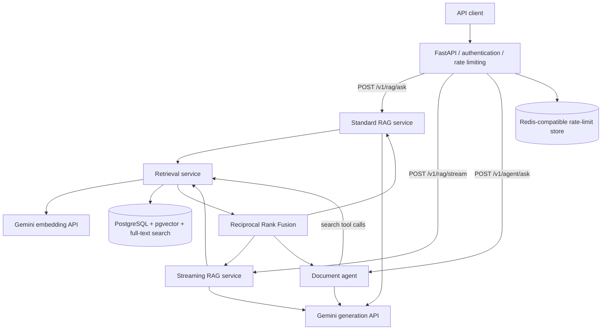

# Agentic RAG API

**A deployed, API-first document assistant built with FastAPI, Gemini, PostgreSQL/pgvector, and Redis.** It supports semantic + keyword retrieval, tool-using document search, grounded answers with citations, and real-time response streaming.

The project explores a practical engineering question: **How do you turn an LLM prototype into a testable, observable, and deployable backend service?**

**Status:** Deployed on Render · Automated tests via GitHub Actions · Protected API endpoints

> **Portfolio demo:** The live API requires an `X-API-Key` to prevent unauthorized use of paid AI services. Add a short demo video or screenshots here if sharing the repository publicly.

## What it does

- **Standard RAG:** Retrieves relevant document chunks and generates an answer from the retrieved context.
- **Hybrid search:** Combines vector similarity (Gemini embeddings + pgvector) with PostgreSQL full-text search, then merges rankings using **Reciprocal Rank Fusion (RRF)**.
- **Agentic RAG:** Uses Gemini tool calling to decide when to search documents, perform follow-up searches, and answer using retrieved evidence.
- **Citation handling:** Assigns stable citation IDs to retrieved chunks within an agent interaction and checks generated citation references against the evidence registry.
- **Real-time streaming:** Delivers answer text through Server-Sent Events (SSE), including completion and error events.
- **Groundedness evaluation:** Includes a separate LLM-as-a-judge experiment that classifies claims as `supported`, `contradicted`, or `insufficient_evidence` against supplied evidence.
- **Operational safeguards:** API-key authentication, Redis-backed rate limiting, bounded agent tool usage, generation timeouts, SDK retries, and timing logs.
- **Deployment and CI:** Dockerized API deployed on Render with managed PostgreSQL and Redis-compatible storage; GitHub Actions runs the pytest suite on code changes.

## Architecture



**Document ingestion** is handled separately: load text → split into overlapping chunks → generate document embeddings → store chunks and vectors in PostgreSQL. Re-ingesting a source replaces its chunks within a database transaction.

### Retrieval and answer flow

1. Convert the question into a query embedding.
2. Run semantic similarity search and PostgreSQL full-text search.
3. Combine the ranked results using Reciprocal Rank Fusion.
4. Provide retrieved evidence to the LLM, with instructions to avoid unsupported answers.
5. For agentic requests, allow additional bounded search tool calls when needed.
6. Return an answer and source information; the streaming endpoint emits SSE events incrementally.

**Important distinction:** Valid citation IDs show that a cited source was retrieved; they do **not** prove that every statement is supported by that source. This is why the project also includes a separate groundedness-evaluation experiment.

## Tech stack

| Layer | Technology |
| --- | --- |
| API | Python 3.14, FastAPI, Pydantic |
| AI | Google Gemini (generation, embeddings, tool calling / Interactions API) |
| Retrieval | PostgreSQL 17, pgvector, PostgreSQL full-text search, RRF |
| Persistence | SQLAlchemy (async), asyncpg, Alembic |
| Security / traffic control | API-key authentication, Redis-backed rate limiting |
| Streaming | Server-Sent Events (SSE) |
| Testing | pytest, pytest-asyncio, HTTPX, mocked AI services |
| Infrastructure | Docker, Docker Compose, Render |
| CI | GitHub Actions |

## API endpoints

| Method | Route | Description | Authentication |
| --- | --- | --- | --- |
| `GET` | `/health` | Process-level health check | No |
| `POST` | `/v1/rag/ask` | Standard RAG answer with sources | `X-API-Key` |
| `POST` | `/v1/rag/stream` | Stream an answer as SSE events | `X-API-Key` |
| `POST` | `/v1/agent/ask` | Agentic retrieval with tool calls and citations | `X-API-Key` |

### Standard RAG

```bash
curl -X POST "http://localhost:8000/v1/rag/ask" \
  -H "Content-Type: application/json" \
  -H "X-API-Key: YOUR_LOCAL_API_SECRET" \
  -d '{"question":"What is the annual leave policy?"}'
```

Example response shape (illustrative):

```json
{
  "answer": "Employees receive 25 working days of annual leave.",
  "sources": [
    {
      "source_file": "sample.txt",
      "chunk_index": 1,
      "similarity": 0.82,
      "rrf_score": 0.0164
    }
  ]
}
```

The sample values above are illustrative, not measured retrieval scores.

### Agentic RAG

```bash
curl -X POST "http://localhost:8000/v1/agent/ask" \
  -H "Content-Type: application/json" \
  -H "X-API-Key: YOUR_LOCAL_API_SECRET" \
  -d '{"question":"Compare the annual leave and sick leave policies."}'
```

The response includes the generated `answer`, a list of `search_queries`, and `cited_sources` IDs. The agent is constrained by configured limits on tool calls and interaction rounds.

### Streaming RAG

```bash
curl -N -X POST "http://localhost:8000/v1/rag/stream" \
  -H "Content-Type: application/json" \
  -H "X-API-Key: YOUR_LOCAL_API_SECRET" \
  -d '{"question":"Summarize the annual leave policy."}'
```

SSE uses `token` events for incremental output, `done` for successful completion, and `error` for a failure after streaming has started. Once a stream has begun, an HTTP `200` status alone does not guarantee successful generation; clients should inspect the terminal event.

## Run locally

### Prerequisites

- Docker and Docker Compose
- A Gemini API key
- A local `.env` file containing the settings required by `src/config.py`

1. **Clone the repository** and enter the project directory.
2. **Create `.env`** with your own development values. The application requires database settings (`RAG_DB_USER`, `RAG_DB_PASSWORD`, `RAG_DB_HOST`, `RAG_DB_PORT`, `RAG_DB_NAME`), a `REDIS_URL`, `GEMINI_API_KEY`, `API_SECRET`, and additional settings defined in `src/config.py` (including external database URLs used by local administrative scripts). For Docker Compose networking, use `db:5432` for PostgreSQL and `redis:6379` for Redis.
3. **Start the services:**

   ```bash
   docker compose up --build -d
   docker compose ps
   ```

4. **Apply migrations** against the intended local database. Ensure the PostgreSQL `vector` extension is enabled before creating vector columns:

   ```sql
   CREATE EXTENSION IF NOT EXISTS vector;
   ```

   ```bash
   docker compose exec app alembic upgrade head
   ```

   The command must point at your intended development database. You can also run Alembic from a configured host Python environment.

5. **Ingest example documents** using the project's ingestion script:

   ```bash
   docker compose exec app python -m scripts.ingest_document
   ```

   The script loads the configured sample text file, chunks it, generates embeddings, and writes them to PostgreSQL.
6. **Verify the API:**

   ```bash
   curl http://localhost:8000/health
   ```

   Then test an authenticated endpoint using the examples above.

> **Configuration note:** This project separates container-internal database addresses from host-machine/external connections. Verify your `.env` and migration target before running migrations or ingestion, especially when connecting to a cloud database. Never commit real credentials.

## Tests and CI

Run the test suite locally:

```bash
python -m pytest -q
```

The tests exercise HTTP request validation, mocked RAG/agent interactions, tool calling, streaming response behavior, error handling, and generation timeouts. Most tests avoid live Gemini calls by substituting mock clients or services.

The GitHub Actions workflow at `.github/workflows/tests.yml` installs Python dependencies and runs pytest for pushes and pull requests to `main`. CI uses **dummy, syntactically valid environment configuration** rather than production credentials. Tests that truly require a database or Redis must be supplied with separate test services.

## Reliability and security decisions

- **Scoped database sessions:** Open sessions only around database operations, avoiding holding a connection while waiting for LLM generation.
- **Bounded tool execution:** Limit agent tool calls and iterations to prevent unbounded workflows.
- **Stream lifecycle checks:** Require successful upstream completion; report partial-stream failures through SSE `error` events.
- **Timeouts and retries:** Apply generation deadlines and configure bounded retries with backoff and jitter through the Gemini SDK.
- **Least-privilege access:** Protect AI routes with an API key; keep health checks public. Rate limiting is backed by Redis rather than individual in-process counters.
- **Operational visibility:** Record embedding, database retrieval, generation, time-to-first-token, and total streaming durations. For deployments with sensitive data, prompt and document contents should be excluded from routine logs.

The application is a **portfolio/learning project deployed to real cloud infrastructure**, not a claim of security certification, high-availability guarantees, or proven large-scale performance.

## Evaluation

A small, human-labeled claim-level dataset checks whether a separate Gemini-based judge can distinguish:

- **Supported:** The evidence establishes the full claim.
- **Contradicted:** The evidence explicitly conflicts with a claim.
- **Insufficient evidence:** The evidence cannot establish the full claim.

The initial five-case experiment passed **5/5 cases**. This validates the evaluation pipeline on those cases, **not** the general reliability of the judge on unseen documents or real-world claims.

## Deployment

The application is deployed on **Render** as a Docker-based web service, connected to managed PostgreSQL (pgvector) and Redis-compatible Key Value storage. Production secrets are configured as environment variables rather than embedded into the Docker image.

The initial deployment included enabling pgvector, applying Alembic migrations, ingesting documents, and verifying all API endpoints. GitHub Actions provides automated test feedback on repository changes; it is separate from Render's deployment trigger unless the deployment workflow is explicitly gated on CI.

## Known limitations / next steps

- The ingestion workflow currently targets text documents and is run as an administrative script rather than a public upload pipeline.
- Citation-reference validation is not the same as proof that generated claims are factually supported.
- The five-case groundedness evaluation is a starting point, not a representative production benchmark.
- The private API-key model is suitable for trusted callers; a public multi-user product would require user-level identity, authorization, and abuse controls.
- This project has not been load-tested or validated for high-availability production workloads.

---

**Project focus:** Backend architecture, retrieval quality, safe agent/tool integration, streaming protocols, testing, deployment, and failure-aware AI engineering—not simply calling an LLM API.
